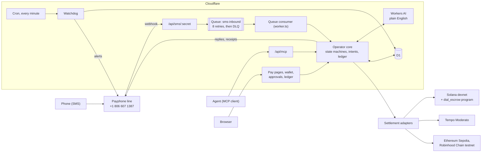

# Dial operator

The Dial operator does agentic peer-to-peer crypto payments. People use it by SMS: text **+1 806 607 1387** and send, request, invoice, receive and withdraw stablecoins with plain sentences, from any phone, with no app and no wallet address. Agents use the same operator through an MCP server, and a person still approves every payment from a text. It runs on testnets only. Powered by [Dial.Work](https://dial.work).

- Live site: https://text-my-crypto.raspy-thunder-20d2.workers.dev
- Public ledger: https://text-my-crypto.raspy-thunder-20d2.workers.dev/ledger
- Demo video: TODO (link to be added)

```
you: hi
op:  hi, I'm the Dial operator. I can help you text your crypto. What name should people use to pay you?
you: alex
you: send jeremy $10 for pizza
op:  What's jeremy's number?
you: (806) 555 0142
op:  Send $10 USDC to jeremy (pizza) on Solana? Reply 482913 to confirm.
you: 482913
op:  Sent $10 to jeremy. They have 7 days to claim it.
```

## Try it in 2 minutes

### With a phone

1. Text `hi` to **+1 806 607 1387**.
2. Reply with a name. You get a handle (for example `@alex`) and a small amount of test USDC to try it with. It is play money.
3. Text `send @someone $1`, using a friend's handle, or `send $1 to <their phone number>`. Add `on tempo`, `on ethereum` or `on robinhood` to pick a chain; Solana is the default.
4. The operator replies with a 6-digit code. Text the code back to approve.
5. You get `Sending…` and then a receipt with the explorer link. The payment also shows on [/ledger](https://text-my-crypto.raspy-thunder-20d2.workers.dev/ledger).

Paying a number that isn't on Dial puts the money in escrow (the Solana escrow program below). The recipient claims it with a code texted to their phone, or you text `reclaim` after 7 days.

Other commands: `balance`, `411 <name>`, `request $25 from adam for pizza`, `invoice sam $200 for logo design`, `receive`, `withdraw $10 to <address>`, `wallet`, `upgrade` (add a passkey), `connect agent`, `revoke agents`, `status`, `help`, `STOP`.

### Without a phone

- **Pay page:** every handle has one, Zelle style: [/@alex?amount=5&note=pizza](https://text-my-crypto.raspy-thunder-20d2.workers.dev/@alex?amount=5&note=pizza). Agents read the same page as JSON at [/@alex.json](https://text-my-crypto.raspy-thunder-20d2.workers.dev/@alex.json).
- **Ledger:** [/ledger](https://text-my-crypto.raspy-thunder-20d2.workers.dev/ledger) lists every settled payment linked to its transaction. [/ledger.json](https://text-my-crypto.raspy-thunder-20d2.workers.dev/ledger.json) has the payments, stats, treasury addresses and escrow program.
- **For LLMs:** [/llms.txt](https://text-my-crypto.raspy-thunder-20d2.workers.dev/llms.txt) describes the service, the MCP tools and the chains.
- **Connect an agent:** see [For agents](#for-agents). Getting a key needs one text from a Dial account.

## Chains

Production settles on the chains listed in `CHAINS` in `wrangler.jsonc`: `solana,tempo,ethereum,robinhood`. Network details come from `src/lib/settlement/registry.ts`; treasury addresses come from [/ledger.json](https://text-my-crypto.raspy-thunder-20d2.workers.dev/ledger.json). "Live" means payments from texts have settled there and are on the ledger. "Enabled" means it is switched on in production.

| Chain | Network | Status | Treasury | Stablecoin |
| --- | --- | --- | --- | --- |
| Solana | Solana devnet | Live | [`DfY9ax…GxW5`](https://explorer.solana.com/address/DfY9axb2gcxAz4EHCgx9NJpFpDjH22VTFRdPc7dpGxw5?cluster=devnet) | Circle test USDC [`4zMMC9…DncDU`](https://explorer.solana.com/address/4zMMC9srt5Ri5X14GAgXhaHii3GnPAEERYPJgZJDncDU?cluster=devnet) |
| Tempo | Tempo Moderato | Enabled | [`0x01cd…C201`](https://explore.testnet.tempo.xyz/address/0x01cd379b7ae08c313DC27e565D36F11c8183C201) | AlphaUSD [`0x20c0…0001`](https://explore.testnet.tempo.xyz/address/0x20c0000000000000000000000000000000000001) |
| Ethereum | Ethereum Sepolia | Enabled | [`0xcc55…2B6f`](https://sepolia.etherscan.io/address/0xcc5583a18a9908b80a20876cd8877048ae792B6f) | Circle test USDC [`0x1c7D…7238`](https://sepolia.etherscan.io/address/0x1c7D4B196Cb0C7B01d743Fbc6116a902379C7238) |
| Robinhood Chain | Robinhood Chain testnet | Enabled | [`0xcc55…2B6f`](https://explorer.testnet.chain.robinhood.com/address/0xcc5583a18a9908b80a20876cd8877048ae792B6f) | Dial Test USD [`0x2195…1e2e`](https://explorer.testnet.chain.robinhood.com/address/0x2195e3E09eab088c90B4461B92D06A74d30c1e2e) |
| Zcash | | In progress | | |

- **Solana:** SPL token transfers with the payment id in a memo. Escrow for people not on Dial goes through the `dial_escrow` program.
- **Tempo:** TIP-20 transfers with the payment id in the 32-byte memo. The treasury co-signs as fee payer, so users hold no gas.
- **Ethereum and Robinhood Chain:** EIP-3009 `transferWithAuthorization`. The user's wallet signs, the treasury submits and pays gas. Robinhood Chain testnet has no Circle test USDC, so Dial deployed [Dial Test USD](contracts/src/DialTestUSD.sol), an ERC-20 with the same EIP-3009 interface. Testnet only; the deployer can mint.
- **Base Sepolia, Arbitrum Sepolia and HyperEVM testnet** are in the registry with the same EVM adapter but are not in `CHAINS`.
- **Zcash** (shielded sends, payment id in the encrypted memo) needs its own wallet service and has no network in the registry yet.

### Solana escrow program

| | |
| --- | --- |
| Program id (devnet) | [`4YiZvobJvYBVrqcT6Lzs8y87iNagzuhu7NWu1zu1vxi3`](https://explorer.solana.com/address/4YiZvobJvYBVrqcT6Lzs8y87iNagzuhu7NWu1zu1vxi3?cluster=devnet) |
| Upgrade authority | `GFFmgkLxChrX3MdFQqbCZPHNcL1J4sda7c383fG5gs88` |
| Attestor (signs claims) | `31v4m3n1VizQqjMQNBhiprgHDbBupzaaNGdWDrHMLxPf` |

`claim` pays the recipient only when the operator's attestor signs, which it does after the recipient enters the code texted to their phone. After expiry, `refund` can be sent by anyone and only pays the sender, so a refund does not need Dial to be up. The program is upgradeable on devnet during the hackathon. The upgrade key is a single keypair held by the project owner, outside git. Before mainnet it moves to a multisig or the program is made immutable. Details, instructions and the deployed binary hash: [solana/README.md](solana/README.md).

## Architecture



One Cloudflare Worker serves everything: Next.js 16 built with OpenNext, plus a custom entry (`worker.ts`) that adds the queue consumer and the cron handler. Data lives in D1 through Drizzle. Each chain has a settlement adapter in `src/lib/settlement/`.

**State machines.** The operator is three small machines, each tested on its own ([docs/STATES.md](docs/STATES.md)). Every inbound text is classified into exactly one input (`code`, `stop`, `pick`, `phone`, free `text` and so on), and `decide` turns it into one action, in a fixed order: compliance first, then onboarding, then answers to a pending question, then a fresh request. Strict grammar handles known commands; Workers AI handles loose phrasing and chat and never invents balances. A conversation per phone number moves between states like `AwaitingName`, `Ready`, `AwaitingNumber` and `OptedOut`. A payment moves `pending → settling → settled`, `escrowed`, `refunded`, `declined` or `failed`, and every transition is a conditional UPDATE, so a payment moves at most once even if two approvals race.

**Security.** Every money movement needs a 6-digit code texted to the payer, bound to that one payment, valid 10 minutes, 5 tries. A forged inbound text can't approve anything because the code only goes to the real phone. Texting `upgrade` adds a passkey; payments over $20 then need it, and the WebAuthn challenge is the payment's hash. Agent keys (`dial_ak_…`) are shown once, stored as SHA-256 hashes, rate-limited per key, and revoked with one text; no MCP tool can approve a payment. Money for people not yet on Dial sits in the on-chain escrow program, not a server wallet. User wallets are custodial on testnet and encrypted at rest. The SMS webhook lives behind a secret path.

**Reliability.** The webhook only enqueues. The consumer retries a failed text up to 8 times, then parks it in a dead-letter queue, and duplicate deliveries are dropped by delivery key. `pnpm ship` is the deploy gate: lint, typecheck, tests, one build, then staging (migrations, deploy, a smoke test that drives the real webhook with fictional 555 numbers), and production only if the smoke test passes. Pushes to `main` run the same gate in CI. In production a cron runs the watchdog every minute: it checks D1, Payphone and every chain's RPC, looks for texts that got no reply or never arrived, and texts the owner in plain words when something breaks and again when it clears.

## For agents

Any MCP client can pay, request from or invoice anyone with a phone number. The person still approves every payment from a text.

1. Text `connect agent` to **+1 806 607 1387** from a Dial account (text `hi` first if you don't have one). You get a one-time link and code. Open the link, enter the code, and the page shows the agent key once.
2. Point your MCP client at `https://text-my-crypto.raspy-thunder-20d2.workers.dev/api/mcp` (Streamable HTTP) with `Authorization: Bearer <key>`.
3. Tools: `whoami`, `get_balance`, `get_receive_address`, `resolve_recipient`, `send_payment`, `request_payment`, `create_invoice`, `withdraw`, `get_payment`, `list_payments`, `get_pay_link`, `get_wallet`.

Money tools create a pending payment, text the payer a code, and return `{ intentId, status: "awaiting_approval", approveUrl }`. The agent polls `get_payment`. `GET /api/wallet` with the same key returns balances and deposit addresses, read-only. Text `revoke agents` to turn off every key.

Install the skill that teaches an agent all of this:

```bash
npx skills add Dial-WTF/text-my-crypto
```

More: [/llms.txt](https://text-my-crypto.raspy-thunder-20d2.workers.dev/llms.txt), [skills/dial-operator/](skills/dial-operator/SKILL.md). Source: `src/app/api/mcp/route.ts`, `src/lib/agents/`.

## Run it locally

Prerequisites: Node 24 and pnpm 10. A Cloudflare account is only needed to deploy. Building the escrow program needs Anchor 0.32.1 and an Agave 2.x toolchain; building the contract needs Foundry.

Secrets live in two gitignored files: `.env.local` for `pnpm dev` and the scripts, and `.dev.vars` for `pnpm run preview`. Never commit either one. Some `wrangler` commands write dotenv files, so back these up before running one.

```bash
pnpm install
node scripts/gen-secrets.mjs >> .env.local   # webhook secret, wallet key, treasury keys
pnpm db:migrate:local
pnpm dev --port 3100
node --env-file=.env.local scripts/sim.mjs +15550001111 "hi"
```

`gen-secrets.mjs` prints the new treasury addresses; fund them from the testnet faucets. Local runs use `SMS_MODE=log`, so replies are printed and never sent. `pnpm dev` handles texts inline because `next dev` has no queue consumer. `pnpm run preview` runs the real worker with a local queue, so it exercises the webhook, queue and consumer path. Use only fictional 555 numbers in local runs and tests.

Checks:

```bash
pnpm lint
pnpm typecheck
pnpm test                    # in-memory SMS stub and SQLite
SOLANA_INT=1 pnpm test       # also runs settlement tests against Solana devnet
pnpm smoke --env local       # the staging smoke test, against pnpm dev
```

The escrow program tests run the built program in LiteSVM: `pnpm exec vitest run tests/settlement/escrow-program.test.ts`.

Deploy with `pnpm ship` (the gate described above; `pnpm ship --staging-only` stops after staging). Runtime secrets go to the Worker with `pnpm secrets:push`. `pnpm run deploy` deploys production directly and skips the gate.

## Repo map

| Path | What's there |
| --- | --- |
| `src/app` | Next.js routes: landing, pay pages (`/@handle`), wallet, approval and agent-key pages, `/ledger`, `/ledger.json`, `/llms.txt`, and the API (`api/sms`, `api/mcp`, `api/pay`, `api/wallet`) |
| `src/lib` | The operator: `bot/` (state machines and router), `operator/` (grammar, replies, language model), `settlement/` (chain adapters and registry), `sms/` (webhook, queue, Payphone), `agents/` (MCP server and keys), `watchdog/`, `db/` |
| `src/ui` | A small themeable UI kit: tokens, themes, primitives, patterns |
| `solana` | The `dial_escrow` Anchor program and its built artifacts |
| `contracts` | `DialTestUSD.sol`, the EIP-3009 test dollar for Robinhood Chain testnet |
| `skills` | `dial-operator`, the agent skill installed by `npx skills add` |
| `docs` | State machines, roadmap, task list |
| `tests` | Vitest suites, mirroring `src/lib` |
| `scripts` | Secrets, simulator, smoke test, deploy gate, chain status |
| `drizzle` | D1 migrations |
| `worker.ts` | Worker entry: HTTP, queue consumer, cron |

## License

TODO: license to be chosen by the owner.
