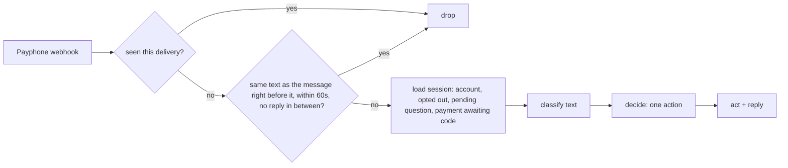
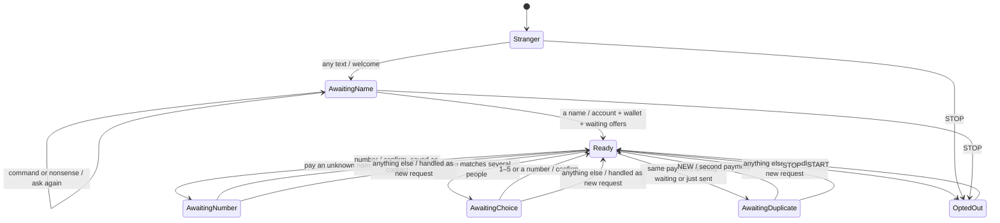
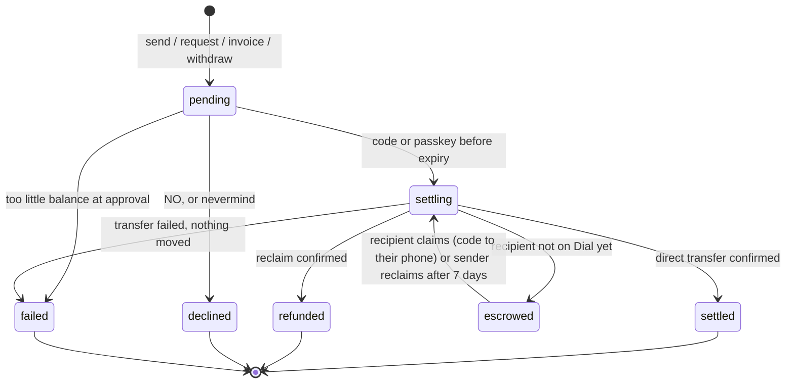

# State machines

The Dial operator is three small machines. Each is code you can read in one sitting and is tested on its own.

| Machine | Code | Tests |
| --- | --- | --- |
| Inbound text → one action | `src/lib/bot/machine/classify.ts`, `decide.ts` | `tests/machine/classify.test.ts`, `decide.test.ts` (every combination) |
| PaymentIntent lifecycle | `src/lib/bot/machine/intent-lifecycle.ts`, `src/lib/intents.ts` | `tests/machine/intent-lifecycle.test.ts`, `tests/intents.test.ts` |
| The router that ties them together | `src/lib/bot/handle-inbound.ts` | `tests/bot/handle-inbound.test.ts`, `edge-cases.test.ts` |

## 1. Every inbound text

`classify` turns any text into exactly one input: `stop`, `start`, `help`, `nevermind`, `new`, `affirm`, `status`, `thanks`, `code` (spaces and dashes allowed), `pick` (1–5), `phone`, `empty`, or free `text`.

`decide` applies these rules in order:

1. **Compliance.** STOP opts out (one confirmation). While opted out, only START gets a reply. HELP always answers.
2. **Onboarding.** Strangers are welcomed and asked for a name; nothing else happens until they give one. A command sent instead of a name gets "first, your name".
3. **Answers to a question the operator asked.** A code approves; nevermind cancels; 1–5 picks from a list; a number answers "what's their number?"; NEW confirms a deliberate repeat; "yes" while a code is pending explains codes.
4. **Everything else** is a fresh request and drops any pending question.

## 2. The conversation (per phone number)

Pending questions expire after 15 minutes.

## 3. A payment

Every arrow is a conditional UPDATE, so a payment moves at most once even if two approvals race.

## Edge cases and what the operator does

| Situation | What happens | Why |
| --- | --- | --- |
| Payphone delivers the same webhook twice | Dropped by delivery key | Never double-process |
| Person double-taps / phone resends before any reply | Only the first is answered | One answer per burst, like a person |
| Same payment asked again after the operator replied | "You already asked… reply CODE, or NEW for a second" | No accidental double payments |
| Same payment right after it went through | "You just sent… reply NEW if you meant another" | Catch fat-finger repeats |
| Same request again | "You already asked @alex…" | No spam to the payer |
| "yes" / "ok" instead of the code | Explains the code | Codes are the safety; don't silently ignore |
| Code typed "482 913" or "482-913" | Accepted | Forgiving input |
| Wrong code | "N tries left"; after 5, locked: "text the payment again" | Brute-force protection with feedback |
| Expired code | "That code expired… text it again" | Specific, actionable |
| Balance dropped between asking and approving | "You only have $X now… nothing moved" | Re-checked at approval |
| Slow chain | "Sending…" immediately, receipt after | Acknowledge first |
| STOP / UNSUBSCRIBE / CANCEL / END / QUIT | Unsubscribed, one confirmation, then silence until START | Carrier compliance |
| Recipient opted out | Never texted; sender told the money waits 7 days | Respect opt-out, keep sender informed |
| Unknown name | "What's their number?", saved as a contact | Ask, then remember |
| Name matches several people | Numbered list, reply 1–5 or a number | Never guess between people |
| Name matches one person | Connects; confirmation shows "@handle (Name)" | Fast, and the code step catches mistakes |
| "nevermind" | Cancels unapproved payments and pending questions | Easy undo |
| Sending to the operator's own number | Refused | Obvious mistake |
| $0 or above the cap | Range explained | Clear limits |
| Command before giving a name | "First, your name" | Account first |
| Request or payment to someone not on Dial | Escrow / request waits; offered again with a fresh code after they join, after their welcome | Nothing gets stuck or lost |
| Any name format ("J. P. Meyer, crypto anarchist") | Becomes "J. P. Meyer", @jpmeyer | Accept people as they type |
| Free-form chat | Language model replies with the last few lines as context | Conversational, never invents balances |
| "Did it work?", "status", "any update?", "??" | The latest payment in one text: sent with receipt, sending, escrowed until a date, expired, cancelled, or waiting. If it is waiting on them, a fresh code | People ask when a reply goes missing; give the answer and the way forward |
| Small talk ("yo", "hello?") while a payment waits on them | "Still waiting on you: $X to Y. Reply with the code, or text status for a new one." The old code keeps working | The likely reason they're texting; a nudge must not cancel a code still in transit |
| A code arriving for a payment that already settled or was cancelled | What happened to that payment, instead of "nothing waiting" | Late or repeated codes get context |
| The canned "I'm the Dial operator…" line would repeat | A different, specific hint instead | Never the same canned reply twice in a row |
| "thanks" | "Anytime." | Small talk gets a human answer |
